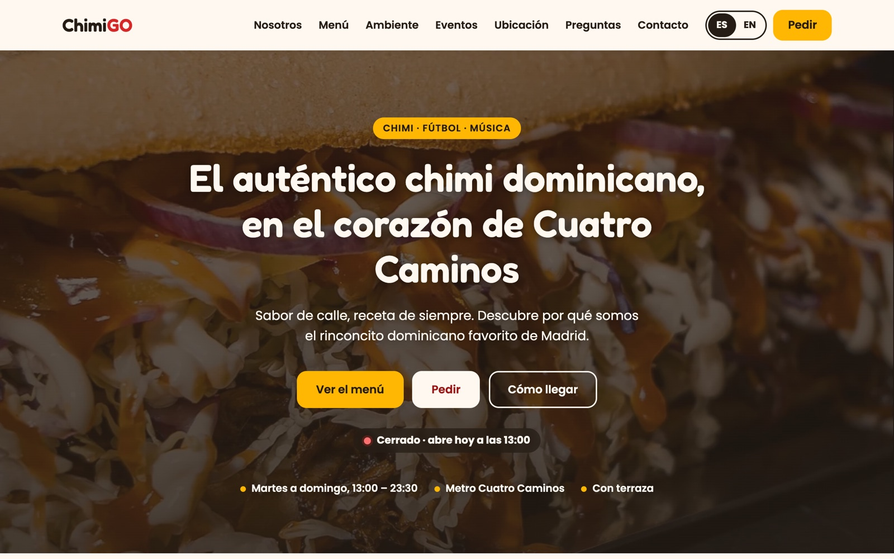
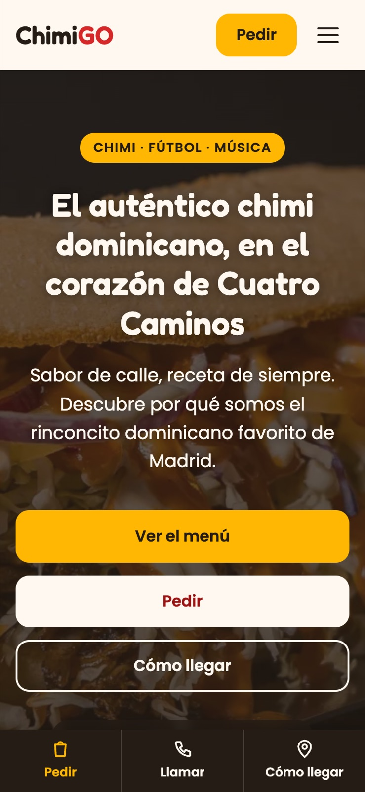
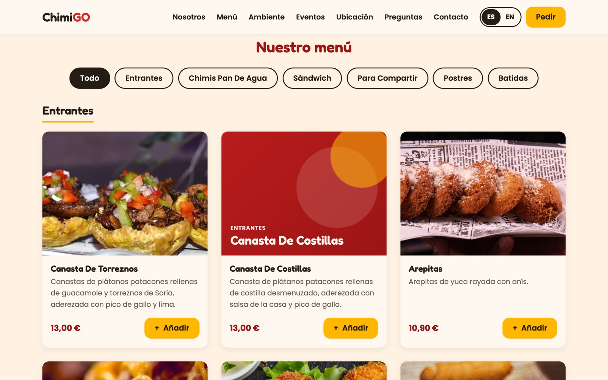
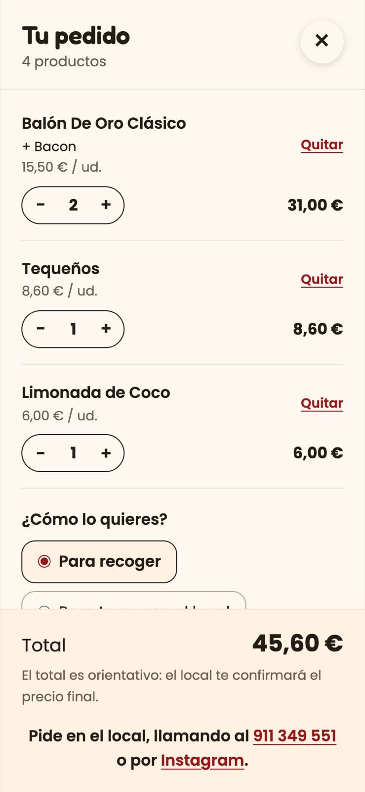

# ChimiGO Urban Food · web de restaurante

## 👉 [Ver la web en vivo: nelsongomezsa.github.io/portfolio-chimigo](https://nelsongomezsa.github.io/portfolio-chimigo/)

**Web para ChimiGO Urban Food, un local de comida callejera dominicana en Cuatro Caminos (Madrid): carta interactiva con carrito, horario en vivo, pedidos y reservas, galería, ES / EN e instalable en el móvil.**


> **English summary:** Production website for a Dominican street-food restaurant in Madrid, in plain HTML, CSS and JavaScript (no frameworks, no dependencies). Interactive menu with category filters and dish details, cart that builds a WhatsApp order, live opening hours in Madrid time, delivery and booking options, accessible photo lightbox, Spanish/English switch, installable PWA that works offline, and Restaurant/Menu structured data. Lighthouse 100 on mobile and desktop.

| Escritorio | Móvil |
|---|---|
|  |  |
|  |  |

---

## Lighthouse

Medido sobre la web publicada (Lighthouse 13.6, 29-10-2026):

| | Rendimiento | Accesibilidad | Buenas prácticas | SEO |
|---|:---:|:---:|:---:|:---:|
| **Móvil** | 100 | 100 | 100 | 100 |
| **Escritorio** | 100 | 100 | 100 | 100 |

En móvil, la página muestra el contenido principal en 1,5 s (LCP), sin bloqueos (TBT 0 ms) y casi sin saltos (CLS 0,006).

## Qué tiene

- **Carta interactiva** con los 31 platos del local: pestañas por categoría (accesibles con teclado), ficha de cada plato con foto grande, cantidad y extras (queso, bacon, patatas, huevo).
- **Carrito** que se guarda al recargar, con nota para el local, opción de recoger o tomar allí, y pedido por WhatsApp ya redactado. Si no hay WhatsApp, remite al teléfono o a Instagram.
- **Horario en vivo** calculado con la hora de Madrid, sea cual sea la zona del visitante: «Abierto ahora · cierra a las 23:30» o «Cerrado · abre el martes a las 13:00», con el día de hoy resaltado.
- **Pedidos y reservas**: recoger en el local, Glovo, Uber Eats o Just Eat, cada una con su color. Solo aparecen las que tienen enlace.
- **Galería** «Chimi · Fútbol · Música» con visor accesible: flechas, Inicio y Fin, Esc y deslizar en el móvil.
- **Eventos privados**, **opiniones** (enlace a Google Maps, sin reseñas inventadas), **preguntas frecuentes** y **contacto**.
- **ES / EN**: traduce la interfaz y las descripciones, y recuerda la elección. Los nombres de los platos se quedan en español.
- **Instalable y sin conexión** (PWA), con manifest, iconos y service worker.
- **Accesibilidad**: enlace para saltar al contenido, foco visible, contraste AA, diálogos nativos (`<dialog>`), avisos para lectores de pantalla y `prefers-reduced-motion`.
- **SEO**: Open Graph con imagen, JSON-LD `Restaurant` con la carta completa (`Menu` y `MenuItem` con precios), horario y reservas, más `sitemap.xml` y `robots.txt`.
- **Rendimiento**: fotos en WebP con JPG de respaldo, `width` y `height` en todas, carga diferida, fuentes que no bloquean y portada precargada.

## Cómo actualizar los datos

Todo lo del local está en **`js/config.js`**: nombre, dirección, horario, teléfono, redes, enlaces de reparto y reservas. La web lee de ahí, y un campo vacío (`""`, `null` o `"PENDIENTE"`) oculta todo lo que depende de él.

```js
contacto: {
  telefono: "+34 911 349 551",
  whatsapp: "",   // con un número, aparece «Pedir por WhatsApp» en el carrito
  email: "",      // con un email, aparece el formulario de contacto
},
pedidos: {
  glovo: "https://glovoapp.com/es/es/madrid/stores/chimigo-madrid",
  uberEats: "",   // con el enlace, aparece la tarjeta de Uber Eats
  justEat: "",
},
horario: {
  lunes: [],                      // [] = cerrado
  martes: [["13:00", "23:30"]],   // varias franjas: [["13:00", "16:00"], ["20:00", "23:30"]]
  // …
},
valoracion: { media: null, numeroOpiniones: null },  // copiar de Google Maps
```

| Quiero cambiar… | Archivo |
|---|---|
| Datos del local | `js/config.js` |
| Platos, precios, extras y descripciones en inglés | `js/menu.js` |
| Fotos de los platos | `img/menu/` (ver `img/menu/LEEME.md`) |
| Fotos de la galería y del local | `js/galeria-datos.js` e `img/local/` (ver `img/local/LEEME.md`) |
| Textos de la interfaz en inglés | `js/i18n.js` |

**Al publicar cambios**, sube `VERSION` en `sw.js` (por ejemplo, de `chimigo-v2` a `chimigo-v3`) para que los móviles que ya tienen la web guardada reciban los archivos nuevos.

## Estructura

```
index.html
manifest.json, sw.js, robots.txt, sitemap.xml
css/styles.css
js/config.js         datos del local
js/menu.js           carta: platos, precios, extras, fotos y traducciones
js/galeria-datos.js  fotos de la galería
js/i18n.js           textos en inglés
js/main.js           datos, horario, pedidos, FAQ y JSON-LD
js/carta.js          menú, ficha y carrito
js/galeria.js        galería y visor
img/                 portada, iconos, og:image y fotos
docs/                capturas y carta original de Glovo (carta-glovo.json)
```

## Stack

| Parte | Técnica |
|---|---|
| Estructura | HTML5 semántico, `<dialog>`, `<details>`, `<picture>` |
| Estilos | CSS con variables propias, flexbox y grid |
| Lógica | JavaScript sin frameworks ni dependencias |
| Sin conexión | Service worker y manifest (PWA) |
| Tipografía | Google Fonts (Poppins y Fredoka) |
| Publicación | GitHub Pages |

## Cómo verla en local

1. Clona el repositorio:
   ```bash
   git clone https://github.com/nelsongomezsa/portfolio-chimigo.git
   ```
2. Sírvela en local, por ejemplo con `python3 -m http.server`, y abre `http://localhost:8000`. El service worker necesita `http://localhost` o `https`: abriendo el archivo directamente funciona todo menos el modo sin conexión.

## Autor

**Nelson Gómez Sánchez** · Estudiante de DAM y del Máster en Data & Analytics · [nelsongomezsa.github.io](https://nelsongomezsa.github.io)
