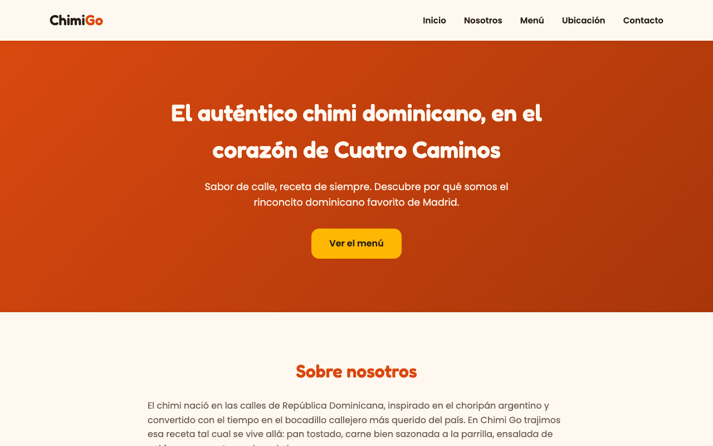

# Chimi Go · web de una sola página

**Web para Chimi Go, un local de comida callejera dominicana en Cuatro Caminos (Madrid): presentación, menú, ubicación y contacto en una sola página.**


> **English summary:** Single-page website for a Dominican street-food place in Madrid, built with semantic HTML and plain CSS: custom properties, flexbox, grid, three responsive breakpoints, an embedded map and a contact form. No frameworks.



---

## Qué tiene

- **Cinco secciones** enlazadas desde el menú: Inicio, Nosotros, Menú, Ubicación y Contacto.
- **Mapa** de Google Maps incrustado en la sección de ubicación.
- **Formulario de contacto** (solo maquetación: no envía datos).
- **Diseño adaptable** con tres puntos de corte (`@media`).

## Stack

| Parte | Técnica |
|---|---|
| Estructura | HTML5 semántico (`header`, `main`, `section`, `footer`) |
| Estilos | CSS con variables propias, flexbox y grid |
| Tipografía | Google Fonts (Poppins y Fredoka) |

## Cómo verla

1. Clona el repositorio:
   ```bash
   git clone https://github.com/nelsongomezsa/portfolio-chimigo.git
   ```
2. Abre `index.html` en el navegador.

## Autor

**Nelson Gómez Sánchez** · Estudiante de DAM y del Máster en Data & Analytics · [nelsongomezsa.github.io](https://nelsongomezsa.github.io)
